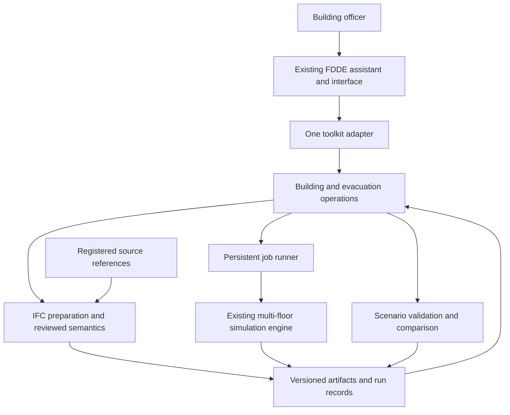

# FDDE Integration and Agent Tool Contract

Status checked: 2026-10-26

The final deliverable is a **building ingestion and multi-floor evacuation module that the FDDE Toolkit can register and call**. A toolkit agent can inspect a model, request preparation, construct a scenario, run it and retrieve a comparison using documented operations. Building officers are the users of the demonstrated workflow.

This is a proposed contract for implementation during the project. No service, tool endpoint or toolkit registration is implemented yet. The target toolkit's actual discovery, execution and deployment interfaces must be agreed in Month 1.

## What agent ready means

The toolkit must be able to discover what the module does, supply valid inputs, track work and interpret the outputs without relying on screen clicks or scraping a prose report. Package the reusable processing and simulation functions behind one thin integration adapter. Any review screen or reference client calls those same functions.

The parent hub's [module library design](https://sgts.gitlab-dedicated.com/wog/htx/egxdata/simulation/research-hub-for-world-model/-/blob/main/fdde-toolkit/simulation-module-library.md) describes versioned manifests with typed inputs/outputs, frame/time declarations, engine bindings and validation limits.[^fdde-modules] This project will supply those records for its tested pilot scope. Integration readiness is separate from graduation to a broadly validated, supported toolkit module.

## Architecture and ownership

| Part | Responsibility |
|---|---|
| This project | IFC preparation, building semantics, scenario checks, one engine adapter, run records, structured comparisons and the toolkit integration package |
| FDDE Toolkit | User conversation, agent/tool discovery, caller identity and permissions, orchestration, shared interface and review workflow |
| Building owner/reviewer | Source information and the review needed to accept model relationships for the stated use |
| Panorama | May later supply governed source/asset references and register accepted derivatives; live Panorama integration is optional for this project |

The project does not need its own language model or general agent framework. Its processing functions should also be callable from a small reference client for testing and handover.

## Proposed operations

Names below are draft logical operation names. The selected toolkit binding may map them to its naming convention. Define a versioned machine-readable input and output schema for each during implementation.

| Operation | Main inputs | Structured output |
|---|---|---|
| `building_inspect` | Registered source reference, requested floor coverage | Job reference, then inventory/quality artifacts, supported coverage and unresolved issues |
| `building_prepare` | Source edition, selection rules, accepted annotation/review references | Job reference, then candidate prepared-model reference, geometry/topology editions, source mappings and readiness findings |
| `evacuation_validate` | Prepared-model edition, occupancy by floor, passage/stair changes, movement profile, run settings | Validation findings, coverage/limits and canonical scenario hash; valid requests receive a scenario and matching validation reference |
| `evacuation_submit` | Scenario reference, matching validation reference, idempotency key, execution budget | Run/job reference and accepted execution settings |
| `job_get` | Job reference | State, current stage, timestamps, available progress, error information and output references |
| `job_cancel` | Job reference | Cancellation request status and current job state |
| `evacuation_compare` | Run references, requested supported measures | Compatible comparison data, run completion classifications, findings/limits and report references |
| `artifact_get` | Artifact reference, supported metadata or bounded-preview request | Edition/hash, type, units, provenance, coverage and an authorised retrieval reference |

Inspection, preparation and simulation use the same job mechanism. A comparison may also return a job reference if it cannot finish promptly. Geometry and trajectories are artifacts referenced by the result; they are not pasted wholesale into the agent conversation.

Source references resolve within the configured workspace or an accepted asset adapter. Do not let a tool call become an arbitrary filesystem, URL-fetching or shell-execution interface. The toolkit supplies caller context; the module checks resource access through the agreed binding.

## Input and output rules

| Contract area | Required behaviour |
|---|---|
| Identity and editions | Pin source, prepared-model, topology, scenario, module and engine versions. Reject an unknown floor, passage or artifact reference |
| Geometry and time | Declare metres/seconds, building frame/transform references and the scenario time origin. Preserve origin floor and occupant identity across levels |
| Parameter validation | Declare required fields, types, supported choices and limits. Unknown properties and unsupported options produce explicit errors rather than silent defaults |
| Model readiness | A prepared candidate carries review findings. Simulation requires the selected model to have the accepted readiness for the named movement profile; the agent cannot manufacture an acceptance by setting a Boolean field |
| Scenario validation | Validate the exact scenario against the exact model/rules. Recheck before submission if the scenario, model, engine binding or applicable review state changed |
| Results | Preserve source/derived origin for preparation artifacts. Label simulation measures `simulated` and derived comparisons with their run provenance; include definitions, units, coverage, assumptions and output references |
| Comparisons | Check compatible coverage, units, time origin, engine/model settings and intended differences. Report incompatible runs rather than presenting an invalid ranking |

JSON Schema can express object fields, required properties and restrictions on additional properties.[^json-schema] Domain rules such as valid source IDs and accepted topology still require application checks.

Return both an execution outcome and a scenario outcome. A job can execute successfully while people remain in stairs at the run horizon. Preserve `completed`, `censored` and `no_eligible_route` findings in results rather than labelling every successful process as completed evacuation.

## Jobs and retry behaviour

Use persistent job IDs and a small initial runner, with one engine job at a time. A proposed lifecycle is `queued → running → succeeded / failed`, with `cancelling → cancelled` when cancellation is requested and confirmed. Record the process actually stopping before reporting `cancelled`.

`job_get` returns the current stage and progress when the engine can provide it; otherwise return an unknown progress value. A lost client connection should not make the toolkit guess whether to launch the simulation again. Reconcile worker/job state after a runner restart, and record interrupted work explicitly.

For submission, scope an idempotency key to caller/workspace and operation. Retrying the same key and canonical inputs returns the existing run. Reusing the key with different inputs returns a conflict. Persist this mapping so a retry cannot silently duplicate a long run after a restart.

Accept explicit run limits such as maximum simulation horizon, repetitions and wall-clock budget, subject to configured limits. The single-person project does not require a distributed scheduler. Keep the engine licence/platform requirements in the module manifest.

## Errors an agent can use

Return a stable code, readable message, affected input, bounded details, retryability and a suggested next step. Initial categories should cover invalid arguments, unknown resources, model review required, unsupported configuration, stale scenario validation, idempotency conflict, unavailable engine, run failure, time limit and incompatible comparison.

An unknown stair ID should identify the invalid field and return the permitted reference lookup. Missing evidence should return the gap and the relevant artifact. An engine failure should retain a diagnostic reference. These responses let the toolkit ask the user for the missing input or adjust a supported scenario without inventing building facts.

## Choose one toolkit binding

**Month 1 decision:** confirm what the FDDE harness can register and call. Keep one common domain contract, then implement one binding compatible with that harness.

- **MCP is a candidate** if the toolkit supports MCP tool discovery. The cited specification describes named tools with input schemas, optional output schemas, structured results and tool execution errors.[^mcp-tools]
- **An HTTP API described with OpenAPI is a candidate** if that matches the toolkit's integration route. OpenAPI describes HTTP service interfaces for machine and human consumers.[^openapi]

These references explain possible interface forms; they do not establish which transport the current FDDE Toolkit uses. Implementing both bindings is optional. Record the selected protocol version and test it against the actual client rather than claiming generic compatibility.

If access to the target toolkit is delayed, a contract test client can verify local behaviour. Label that evidence as local contract testing. A claim of FDDE integration requires an actual installation and workflow demonstration in the agreed toolkit environment.

## Integration package to deliver

1. A versioned module package with its selected toolkit adapter and a reproducible installation/run procedure.
2. A discovery manifest declaring operations, schema versions, owner/contact, task coverage, supported engine binding, resource/licence requirements, artifact types, assumptions and validation evidence.
3. Input/output schemas and small synthetic examples, including missing-data and failed-run responses.
4. Documented job status, cancellation, retries, artifact retrieval and version compatibility.
5. A small reference client and meaningful contract tests, including duplicate submission and result interpretation.
6. A toolkit registration/configuration example, an agent tool-use guide and a recorded end-to-end integration demonstration.

Source code, schema files and packaging are implementation deliverables, not files already present. Engine binaries and licences are supplied according to their terms; configuration identifies their location and required version.

## Acceptance demonstration

An FDDE agent discovers the registered module and reads its declared coverage. Using an accepted prepared model, it creates a baseline and a supported change to floor occupancy or stair-route availability, validates each, submits the runs, monitors progress and obtains a structured comparison. It presents the measures and limitations to a building officer through the existing toolkit workflow.

Also demonstrate invalid floor/stair references, unresolved model evidence, duplicate submission, cancellation, a failed or timed-out run and an incompatible comparison. Check that the agent's explanation matches the returned measurements and references. Human interpretation remains part of the planning use case.

Core completion requires the integration package and evidence of the agreed toolkit workflow. The project may deliver a module suitable for bounded exploration on one pilot building; broader venue validation and toolkit graduation follow the parent library's criteria.[^fdde-modules]

[^fdde-modules]: [Research Hub simulation module library proposal](https://sgts.gitlab-dedicated.com/wog/htx/egxdata/simulation/research-hub-for-world-model/-/blob/main/fdde-toolkit/simulation-module-library.md).
[^mcp-tools]: [MCP tool specification, version 2025-11-25](https://modelcontextprotocol.io/specification/2025-11-25/server/tools).
[^openapi]: [OpenAPI Specification 3.1.1](https://spec.openapis.org/oas/v3.1.1.html), cited as an interface-description reference rather than a claim about the latest version.
[^json-schema]: [JSON Schema object reference](https://json-schema.org/understanding-json-schema/reference/object).
